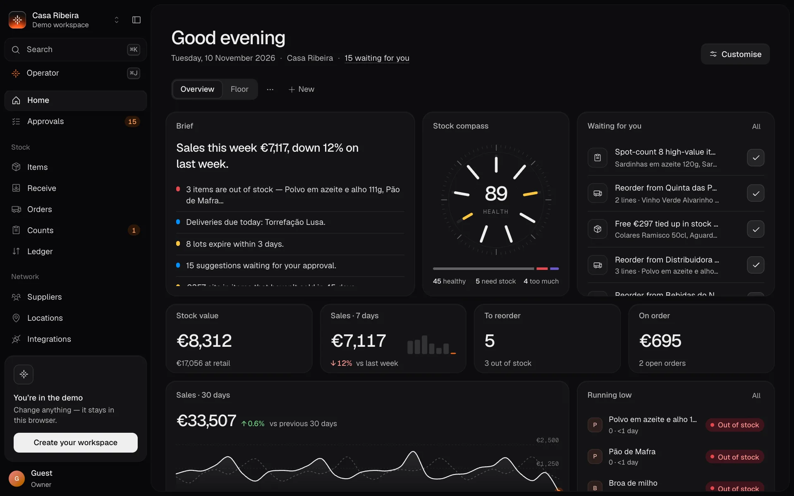
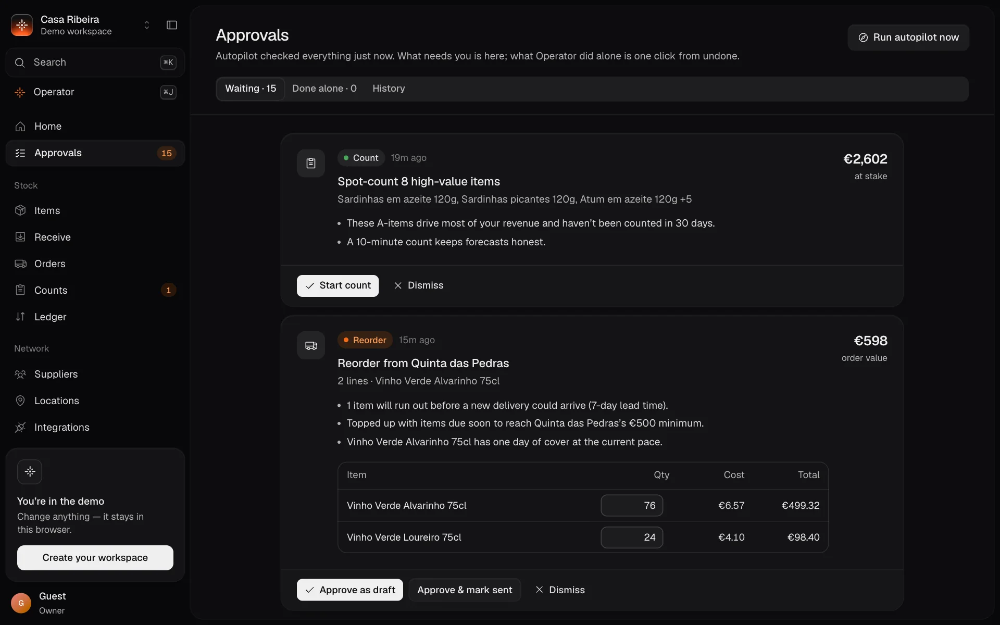
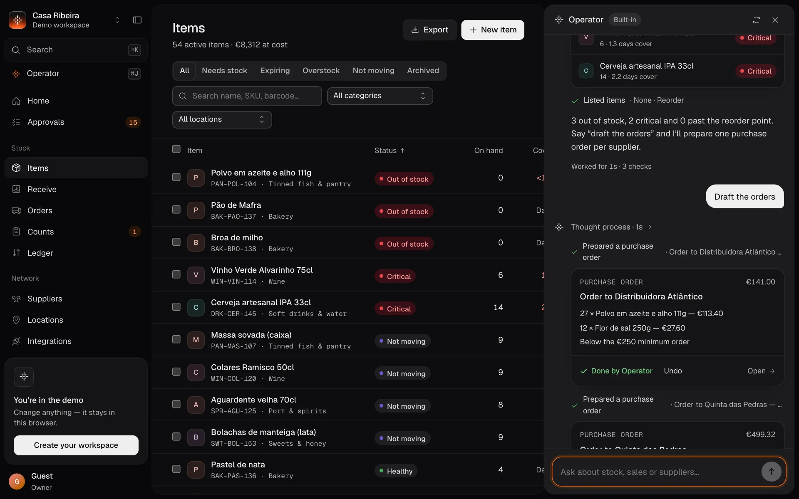
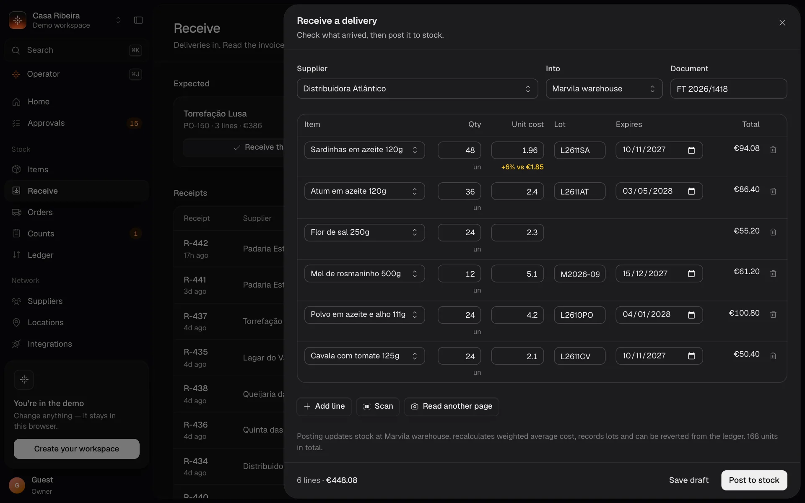
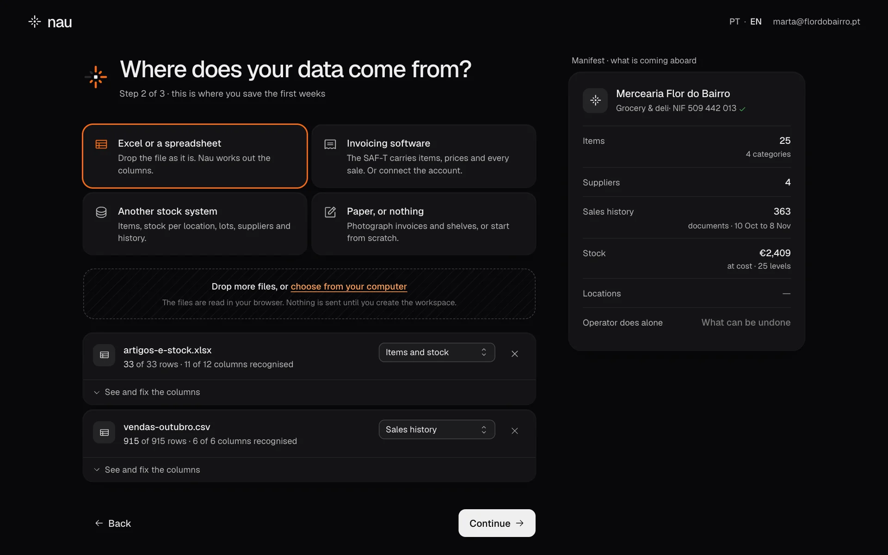
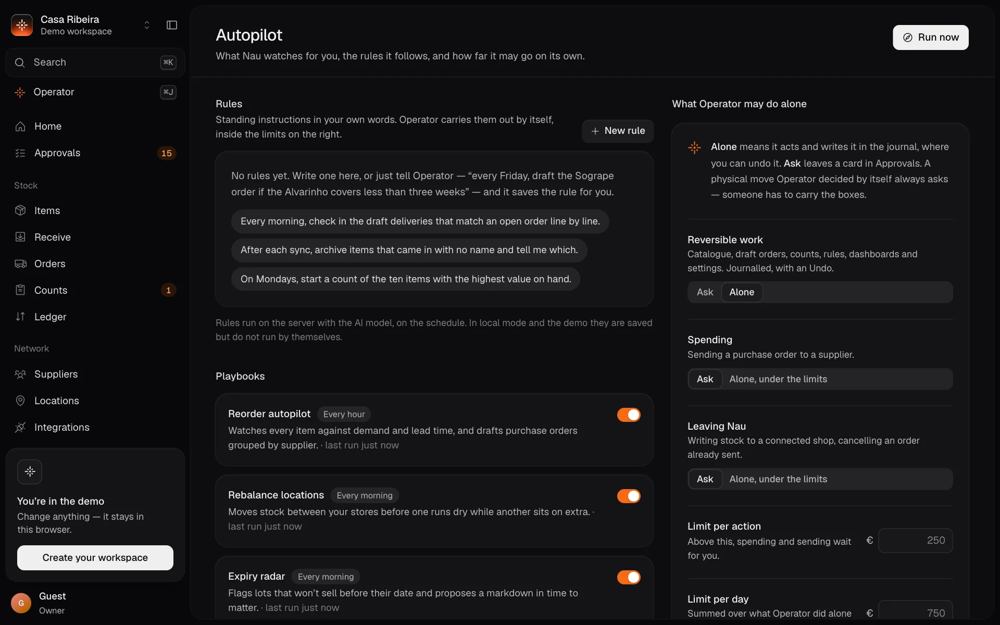
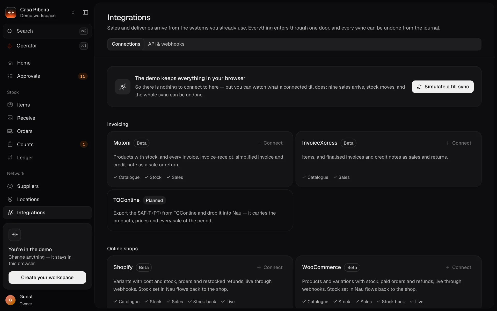

<p align="center">
  <picture>
    <source media="(prefers-color-scheme: dark)" srcset="public/brand/nau-mark-white.svg">
    
  </picture>
</p>

<h1 align="center">Nau</h1>

<p align="center">
  <strong>Inventory that runs itself.</strong><br>
  Open-source stock, deliveries and purchase orders for shops, cafés and restaurants in Portugal.<br>
  An AI operator does the work, a journal remembers it, and people approve what costs money.
</p>

<p align="center">
  <a href="https://s1lvazxy.github.io/nau/en"><strong>Website</strong></a> ·
  <a href="#run-it">Run it</a> ·
  <a href="docs/self-hosting.md">Host it</a> ·
  <a href="docs/api.md">API</a> ·
  <a href="docs/connectors.md">Connectors</a> ·
  <a href="README.pt.md">Português</a>
</p>

<p align="center">
  <a href="https://s1lvazxy.github.io/nau/en">
    
  </a>
</p>

## What it is

A shop's stock lives in four places: the invoicing program, a spreadsheet, the supplier's paper invoice and somebody's head. Nau reads the first three and replaces the fourth.

- **Data comes in by itself.** A spreadsheet, the SAF-T (PT) file that every certified invoicing program exports, a photo of an invoice, seven connectors or the API. All of it goes through one door, and every import can be undone.
- **Operator does the work.** It builds the catalogue, drafts purchase orders grouped by supplier, opens counts, moves stock between shops and writes its own standing rules. Each workspace decides how far it may go alone.
- **People validate.** What can be undone is done and written to a journal with an Undo button. Money, and anything that leaves Nau, waits for a yes, unless you set a limit in euros. Operator never widens its own limits.
- **Made for Portugal.** NIF validation, IVA for the mainland and the islands, the year-end inventory file for the AT, holidays and Santo António in the forecast, purchase orders written the way Portuguese suppliers expect.

There are no plans, no paid tier and no licence key. Every installation has everything, on a laptop or on a company server, and is configured from the environment. The licence is [AGPL-3.0](LICENSE).

## A look around

Every screenshot is the real product running the demo shop: a deli with two shops and a warehouse, 54 products and 90 days of sales.

<table>
  <tr>
    <td width="50%" valign="top">
      
      <br><strong>Home.</strong> The week in one sentence, stock health, what is waiting for you. Drag, resize, or describe the widget you want.
    </td>
    <td width="50%" valign="top">
      
      <br><strong>Approvals.</strong> Each suggestion says why, in euros and in days. Next to it: what Operator did alone, one click from undone.
    </td>
  </tr>
  <tr>
    <td width="50%" valign="top">
      
      <br><strong>Operator.</strong> Ask in plain words. It answers with your numbers and leaves the work done, with an Undo.
    </td>
    <td width="50%" valign="top">
      
      <br><strong>Receive.</strong> Photograph the invoice. Lines are matched to the catalogue, costs are compared with the last delivery, lots are recorded.
    </td>
  </tr>
  <tr>
    <td width="50%" valign="top">
      
      <br><strong>Onboarding.</strong> Drop the files as they are. Nau works out the columns and shows what it understood before anything is created.
    </td>
    <td width="50%" valign="top">
      
      <br><strong>Autopilot.</strong> Standing rules in your own words, and the policy: what Operator may do alone, and up to how many euros.
    </td>
  </tr>
</table>

## Run it

```bash
git clone https://github.com/s1lvazxy/nau && cd nau
pnpm install
pnpm dev            # http://localhost:3100
```

You need Node 22.9 or later and pnpm. With no configuration Nau runs in **local mode**: accounts and data stay in your browser, and Operator uses its built-in engine. Imports, the journal, undo and the policy all work.

There are three ways to run it:

| | What you get | What it needs |
| --- | --- | --- |
| **Try it** | Imports, Operator, journal and undo, in your browser | Node and pnpm: the three lines above |
| **On your computer** | Everything: shared accounts, connectors, the API, webhooks, the scheduled Operator | plus Docker and the Supabase CLI |
| **On a server** | The same, for the whole team, behind your own domain | a Supabase project and a server with Docker |

On your computer:

```bash
supabase start      # database and accounts, in Docker
pnpm setup:local    # fills in .env and generates the secrets
pnpm dev            # everything connected, on localhost:3100
```

On a server:

```bash
supabase db push                # applies the schema to your database
cp .env.example .env            # address, keys and secrets
docker compose up -d --build    # the app and the scheduler
```

[`.env.example`](.env.example) lists every setting, and [docs/self-hosting.md](docs/self-hosting.md) walks through a company installation: database, secrets, the scheduler, backups.

## How Operator is kept in check

Operator has 36 tools. The policy sorts everything it can change into three kinds, and each workspace sets the answer for each:

| Kind of work | For example | Out of the box |
| --- | --- | --- |
| **Reversible** | catalogue, draft orders, counts, rules, dashboards, settings | Done alone. Journalled with an Undo that restores only what it touched. |
| **Money** | sending a purchase order to a supplier | Waits for a person. Can run alone under a limit per action and per day. |
| **Leaves Nau** | writing stock to a connected shop, cancelling an order already sent | Waits for a person. Can run alone under the same limits. |

Two things always wait, whatever the policy says: a physical move that Operator decided by itself (somebody has to carry the boxes), and any change to the policy.

- **With a model.** Set `ANTHROPIC_API_KEY` on the server and Operator runs on Claude. The model never touches the database: it calls tools, the tools validate their input, and every write goes through the policy.
- **Without one.** A built-in engine understands the common requests (what is running low, draft the orders, move stock, forecasts, widgets) and drives the same tools. Nothing is sent anywhere.
- **With nobody watching.** A scheduler calls the server every five minutes. Autopilot checks stock, demand, lots and prices; standing rules run when their turn comes. Rules need the model.

## Integrations



| System | Family | Status |
| --- | --- | --- |
| Moloni, InvoiceXpress | Invoicing | beta |
| Vendus, Square, SumUp | Point of sale | beta |
| Shopify, WooCommerce | Online shops, with stock written back and live webhooks | beta |
| TOConline, Zone Soft, WinRest | | planned: today they come in as SAF-T or through the API |
| Anything else | [REST API and webhooks](docs/api.md), SAF-T (PT), Excel, CSV | available |

**Beta is literal.** Each connector is built and tested against the vendor's public documentation, and none has yet been run against a live account. WooCommerce is also exercised end to end against a stand-in shop. Credentials are sealed with AES-256-GCM and never sent back to a browser. [docs/connectors.md](docs/connectors.md) has the contract and how to add one.

## Two languages

The website, onboarding, the app and Operator's built-in answers are in **Portuguese (Portugal)** and **English**. Switch with `PT · EN` in the header, or under Settings → Appearance. The website is at `/` in Portuguese and `/en` in English.

In the code a string is written once, in place, as `tr('…')`. The translations live in [`src/i18n/pt.ts`](src/i18n/pt.ts) and [`src/i18n/en.ts`](src/i18n/en.ts), and `pnpm i18n` fails when one is missing. The email to a supplier stays in Portuguese in both languages, on purpose.

## Email

Out of the box Nau sends no email. “Send to supplier” opens the order in your own mail app, already written. If whoever hosts the installation sets `RESEND_API_KEY` and `NAU_MAIL_FROM`, purchase orders go out from the server through [Resend](https://resend.com): once each, with replies going to the person who sent them, and with the outcome shown on the order. [The hosting guide](docs/self-hosting.md#email) has the details.

## Under the hood

- **One door for data.** Spreadsheets, SAF-T, photos, connectors and the API all become the same batch and go through the same `ingest()`. Anything from outside gets an id derived from the source's own reference, so a replay changes nothing.
- **One write path.** Every change is a change set applied in one transaction to an append-only ledger. The browser, the connectors, the API and the scheduled Operator all use it.
- **The database keeps tenants apart.** Every table carries `workspace_id` under row-level security. Browsers cannot write to tables: `apply_changeset()` checks the member's role inside Postgres. The server writes through a twin that only the service role may call.

```
src/
  lib/          domain types, Portuguese rules (NIF, IVA, holidays, AT export), analytics, demo data
  data/         change sets, undo, local and cloud backends, commands
  ingest/       the one door: batch format, spreadsheets, SAF-T, file reading
  connectors/   one implementation per outside system, safe HTTP
  agent/        tool schemas, executors, the policy and journal, autopilot, the built-in engine
  server/       everything that needs secrets: sync, public API, webhooks, mail, scheduler, headless Operator
  i18n/         Portuguese and English
  components/   brand, interface primitives, dashboard, Operator chat, onboarding, website
  routes/       pages and server routes
supabase/       migrations
docs/           hosting, API, connectors
```

**Stack.** TanStack Start, Router, Query and Table, React 19, Supabase (Postgres and auth), Zustand, Base UI, Tailwind v4 with Radix Colors, Phosphor, GSAP, vgpu (WebGPU), zod, the Anthropic SDK, Nitro.

```bash
pnpm test                          # 43 unit tests: domain, ingest, connectors, policy, undo, Operator tools
supabase start && pnpm test:int    # 56 with Postgres: tenancy, the server write path, sync, API, webhooks, mail, the scheduler
pnpm typecheck && pnpm i18n && pnpm build
```

The build uses Nitro, so the same code runs on Node, in Docker, on Vercel (`NITRO_PRESET=vercel`) or on Cloudflare Workers (`NITRO_PRESET=cloudflare-module`). [SECURITY.md](SECURITY.md) describes how it is put together and its known limits.

### The website

[s1lvazxy.github.io/nau](https://s1lvazxy.github.io/nau/) is the landing page alone, built as static files with `pnpm build:site` and published by [a workflow](.github/workflows/pages.yml) when a push to `main` changes the code. In a fork, turn on Pages with “GitHub Actions” as the source and it publishes under your own address.

## Where it stands

- No beta connector has been run against a real account yet. The first sync on each deserves watching.
- Sending orders through Resend is tested against a stand-in for Resend's API, not yet against a real Resend account.
- Standing rules need the model. In local mode and in the demo they are saved and do not run by themselves.
- The Terms, Privacy Policy and Data Processing Agreement under `/legal` are templates for whoever hosts an installation. Adapt them and have them reviewed.

## Talk to us

There is no company inbox. The project lives here:

- a question, an idea or a bug: [open an issue](https://github.com/s1lvazxy/nau/issues/new);
- the person who maintains Nau: [@s1lvazxy](https://github.com/s1lvazxy);
- a security problem: [report it in private](https://github.com/s1lvazxy/nau/security/advisories/new), not in a public issue.

[CONTRIBUTING.md](CONTRIBUTING.md) says how to get it running and what a good change looks like. The most useful contribution today is a run of a beta connector against a real account.

## Licence

[AGPL-3.0](LICENSE). If you change Nau and offer it to others over a network, publish your changes under the same licence.
