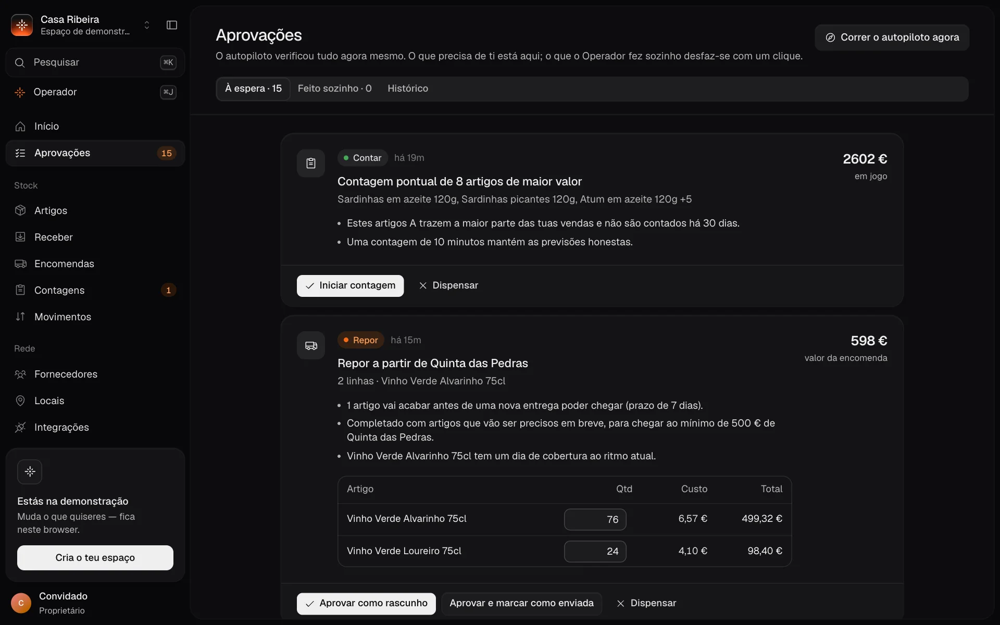
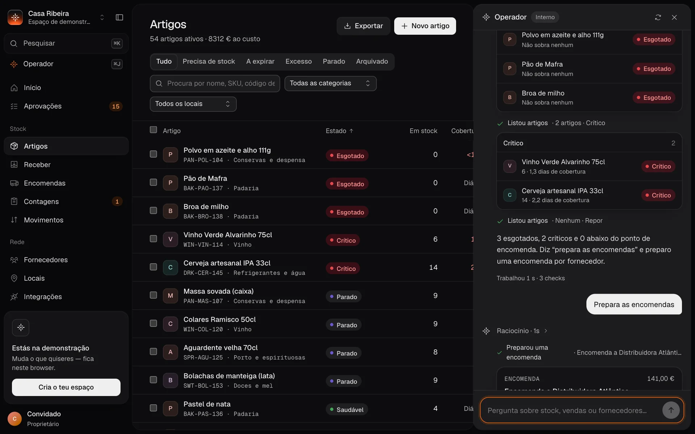
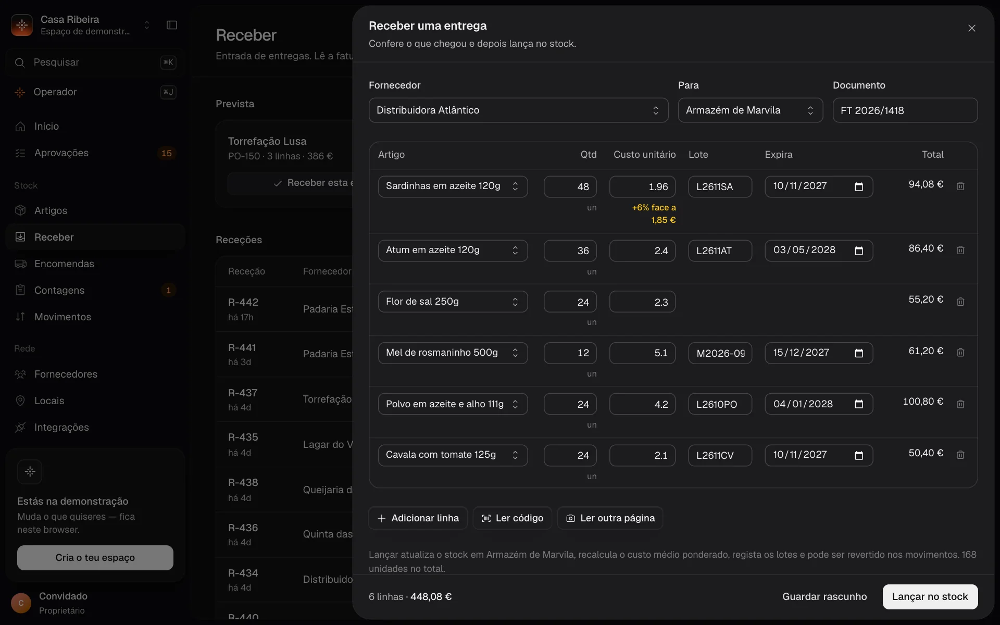
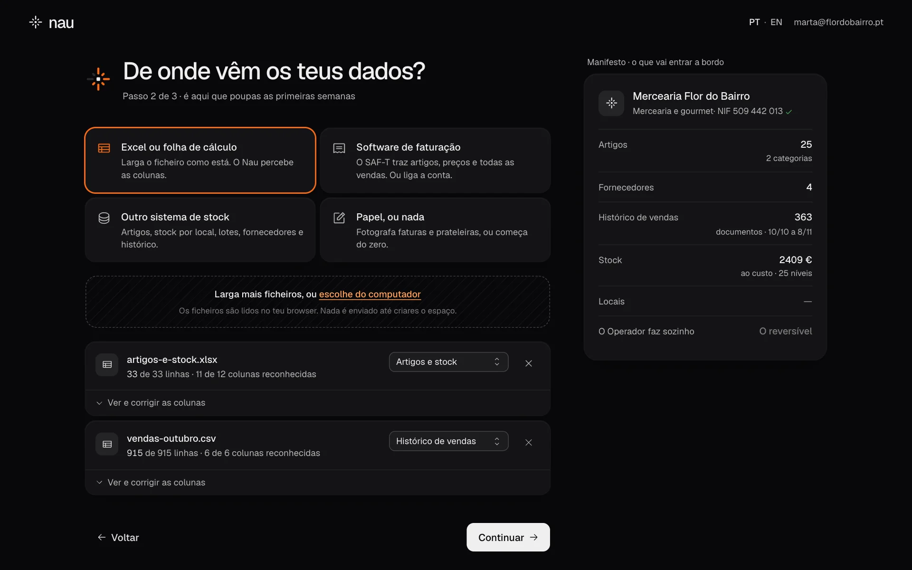
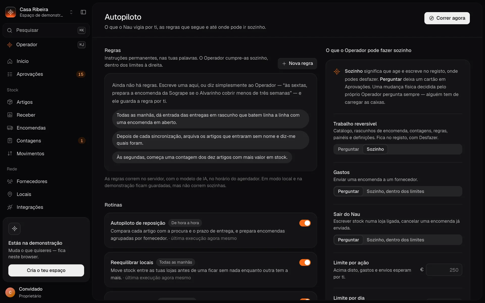
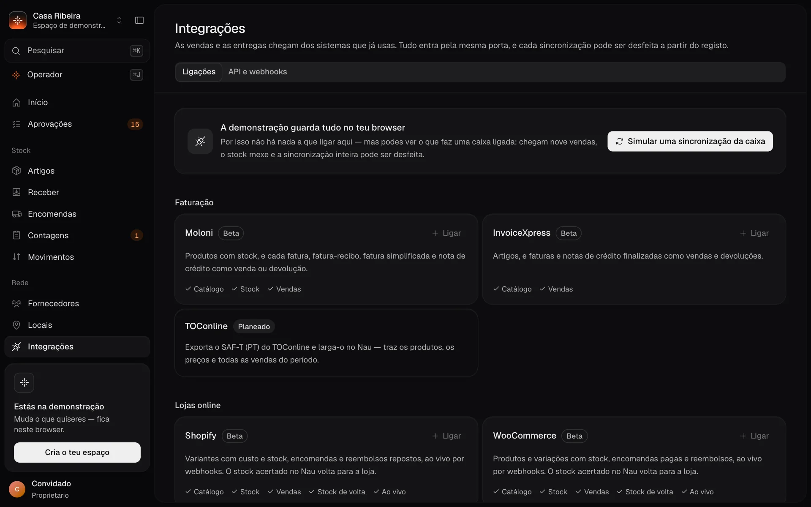

<p align="center">
  <picture>
    <source media="(prefers-color-scheme: dark)" srcset="public/brand/nau-mark-white.svg">
    
  </picture>
</p>

<h1 align="center">Nau</h1>

<p align="center">
  <strong>O stock que se gere sozinho.</strong><br>
  Stock, entregas e encomendas em código aberto, para lojas, cafés e restaurantes em Portugal.<br>
  Um operador de IA faz o trabalho, um registo guarda tudo, e as pessoas aprovam o que custa dinheiro.
</p>

<p align="center">
  <a href="https://s1lvazxy.github.io/nau/"><strong>Website</strong></a> ·
  <a href="#instalar">Instalar</a> ·
  <a href="docs/self-hosting.md">Alojar</a> ·
  <a href="docs/api.md">API</a> ·
  <a href="docs/connectors.md">Conectores</a> ·
  <a href="README.md">English</a>
</p>

<p align="center">
  <a href="https://s1lvazxy.github.io/nau/">
    
  </a>
</p>

## O que é

O stock de uma loja vive em quatro sítios: o programa de faturação, uma folha de cálculo, a fatura em papel do fornecedor e a cabeça de alguém. O Nau lê os três primeiros e substitui o quarto.

- **Os dados entram sozinhos.** Uma folha de cálculo, o ficheiro SAF-T (PT) que qualquer programa de faturação certificado exporta, a fotografia de uma fatura, sete conectores ou a API. Tudo entra pela mesma porta, e cada importação pode ser desfeita.
- **O Operador faz o trabalho.** Monta o catálogo, prepara encomendas agrupadas por fornecedor, abre contagens, move stock entre lojas e escreve as suas próprias regras. Cada espaço de trabalho decide até onde ele pode ir sozinho.
- **As pessoas validam.** O que se pode desfazer é feito e fica num registo, com um botão Desfazer. O dinheiro, e tudo o que sai do Nau, espera por um sim, a não ser que definas um limite em euros. O Operador nunca alarga os próprios limites.
- **Feito para Portugal.** Validação de NIF, IVA do continente e das ilhas, o ficheiro de inventário de fim de ano para a AT, feriados e Santo António na previsão, encomendas escritas como os fornecedores portugueses esperam.

Não há planos, nem versão paga, nem chave de licença. Cada instalação tem tudo, num portátil ou no servidor da empresa, e configura-se pelo ambiente. A licença é [AGPL-3.0](LICENSE).

## Uma volta pelo produto

Todas as capturas são o produto real a correr a loja de demonstração: uma mercearia fina com duas lojas e um armazém, 54 produtos e 90 dias de vendas.

<table>
  <tr>
    <td width="50%" valign="top">
      
      <br><strong>Início.</strong> A semana numa frase, a saúde do stock, o que está à tua espera. Arrasta, redimensiona ou descreve o widget que queres.
    </td>
    <td width="50%" valign="top">
      
      <br><strong>Aprovações.</strong> Cada sugestão diz porquê, em euros e em dias. Ao lado: o que o Operador fez sozinho, a um clique de ser desfeito.
    </td>
  </tr>
  <tr>
    <td width="50%" valign="top">
      
      <br><strong>Operador.</strong> Pergunta por palavras tuas. Responde com os teus números e deixa o trabalho feito, com Desfazer.
    </td>
    <td width="50%" valign="top">
      
      <br><strong>Receber.</strong> Fotografa a fatura. As linhas ligam-se ao catálogo, os custos comparam-se com a última entrega, os lotes ficam registados.
    </td>
  </tr>
  <tr>
    <td width="50%" valign="top">
      
      <br><strong>Arranque.</strong> Larga os ficheiros como estão. O Nau percebe as colunas e mostra o que entendeu antes de criar o que quer que seja.
    </td>
    <td width="50%" valign="top">
      
      <br><strong>Autopiloto.</strong> Regras permanentes, nas tuas palavras, e a política: o que o Operador pode fazer sozinho, e até quantos euros.
    </td>
  </tr>
</table>

## Instalar

```bash
git clone https://github.com/s1lvazxy/nau && cd nau
pnpm install
pnpm dev            # http://localhost:3100
```

Precisas de Node 22.9 ou superior e de pnpm. Sem configuração nenhuma, o Nau corre em **modo local**: as contas e os dados ficam no teu browser e o Operador usa o motor interno. Importações, registo, desfazer e política funcionam.

Há três maneiras de o correr:

| | O que tens | O que é preciso |
| --- | --- | --- |
| **Experimentar** | Importações, Operador, registo e desfazer, no teu browser | Node e pnpm: as três linhas acima |
| **No teu computador** | Tudo: contas partilhadas, conectores, API, webhooks, o Operador agendado | mais Docker e a CLI do Supabase |
| **No servidor** | O mesmo, para a equipa toda, atrás do teu domínio | um projeto Supabase e um servidor com Docker |

No teu computador:

```bash
supabase start      # base de dados e contas, em Docker
pnpm setup:local    # preenche o .env e gera os segredos
pnpm dev            # tudo ligado, em localhost:3100
```

No servidor:

```bash
supabase db push                # aplica o esquema à tua base de dados
cp .env.example .env            # endereço, chaves e segredos
docker compose up -d --build    # a aplicação e o agendador
```

O [`.env.example`](.env.example) lista todas as definições, e o [guia de alojamento](docs/self-hosting.md) (em inglês) acompanha uma instalação de empresa: base de dados, segredos, agendador, cópias de segurança.

## Como o Operador é mantido na linha

O Operador tem 36 ferramentas. A política divide tudo o que ele pode mudar em três tipos, e cada espaço de trabalho define a resposta para cada um:

| Tipo de trabalho | Por exemplo | De origem |
| --- | --- | --- |
| **Reversível** | catálogo, rascunhos de encomenda, contagens, regras, painéis, definições | Faz sozinho. Fica no registo, com um Desfazer que repõe só o que foi tocado. |
| **Gastos** | enviar uma encomenda a um fornecedor | Espera por uma pessoa. Pode correr sozinho abaixo de um limite por ação e por dia. |
| **Sair do Nau** | escrever stock numa loja ligada, cancelar uma encomenda já enviada | Espera por uma pessoa. Pode correr sozinho dentro dos mesmos limites. |

Duas coisas esperam sempre, diga a política o que disser: uma mudança física decidida pelo próprio Operador (alguém tem de carregar as caixas) e qualquer alteração à política.

- **Com um modelo.** Define `ANTHROPIC_API_KEY` no servidor e o Operador corre com o Claude. O modelo nunca toca na base de dados: chama ferramentas, as ferramentas validam o que recebem, e cada escrita passa pela política.
- **Sem modelo.** Um motor interno percebe os pedidos mais comuns (o que está a acabar, prepara as encomendas, move stock, previsões, widgets) e usa as mesmas ferramentas. Nada é enviado para lado nenhum.
- **Sem ninguém a ver.** Um agendador chama o servidor de cinco em cinco minutos. O autopiloto verifica stock, procura, lotes e preços; as regras permanentes correm quando chega a sua vez. As regras precisam do modelo.

## Integrações



| Sistema | Família | Estado |
| --- | --- | --- |
| Moloni, InvoiceXpress | Faturação | beta |
| Vendus, Square, SumUp | Ponto de venda | beta |
| Shopify, WooCommerce | Lojas online, com stock escrito de volta e webhooks ao vivo | beta |
| TOConline, Zone Soft, WinRest | | planeado: hoje entram por SAF-T ou pela API |
| Qualquer outro | [API REST e webhooks](docs/api.md), SAF-T (PT), Excel, CSV | disponível |

**Beta é à letra.** Cada conector foi construído e testado contra a documentação pública do fornecedor, e nenhum correu ainda numa conta real. O WooCommerce é também exercitado de ponta a ponta contra uma loja de substituição. As credenciais são cifradas com AES-256-GCM e nunca voltam ao browser. O contrato, e como juntar um conector, estão em [docs/connectors.md](docs/connectors.md).

## Duas línguas

O site, o arranque, a aplicação e as respostas do motor interno do Operador estão em **português (Portugal)** e em **inglês**. Troca-se em `PT · EN` no cabeçalho, ou em Definições → Aparência. O site está em `/` em português e em `/en` em inglês.

No código, um texto escreve-se uma vez, no sítio, como `tr('…')`. As traduções vivem em [`src/i18n/pt.ts`](src/i18n/pt.ts) e [`src/i18n/en.ts`](src/i18n/en.ts), e `pnpm i18n` falha quando falta alguma. O email para o fornecedor fica em português nas duas línguas, de propósito.

## Email

De origem, o Nau não envia emails. «Enviar ao fornecedor» abre a encomenda na tua aplicação de email, já escrita. Se quem aloja a instalação definir `RESEND_API_KEY` e `NAU_MAIL_FROM`, as encomendas saem do servidor através do [Resend](https://resend.com): uma vez cada, com as respostas a irem para quem as enviou, e com o resultado à vista na encomenda. Os detalhes estão no [guia de alojamento](docs/self-hosting.md#email).

## Por dentro

- **Uma só porta para os dados.** Folhas de cálculo, SAF-T, fotografias, conectores e API tornam-se o mesmo lote e passam pelo mesmo `ingest()`. O que vem de fora recebe um id derivado da referência de origem, por isso repetir não muda nada.
- **Um só caminho de escrita.** Cada alteração é um conjunto de mudanças aplicado numa transação a um livro de movimentos que só cresce. O browser, os conectores, a API e o Operador agendado usam todos o mesmo.
- **A base de dados separa os inquilinos.** Todas as tabelas têm `workspace_id`, com segurança ao nível da linha. Os browsers não escrevem em tabelas: `apply_changeset()` verifica a função do membro dentro do Postgres. O servidor escreve por uma função gémea que só o papel de serviço pode chamar.

```
src/
  lib/          tipos do domínio, regras portuguesas (NIF, IVA, feriados, exportação AT), análise, dados de demonstração
  data/         conjuntos de mudanças, desfazer, backends local e na cloud, comandos
  ingest/       a porta única: formato do lote, folhas de cálculo, SAF-T, leitura de ficheiros
  connectors/   uma implementação por sistema externo, HTTP seguro
  agent/        esquemas das ferramentas, executores, política e registo, autopiloto, motor interno
  server/       tudo o que precisa de segredos: sincronização, API pública, webhooks, email, agendador, Operador sem interface
  i18n/         português e inglês
  components/   marca, primitivas de interface, painel, conversa do Operador, arranque, site
  routes/       páginas e rotas de servidor
supabase/       migrações
docs/           alojamento, API, conectores
```

**Tecnologia.** TanStack Start, Router, Query e Table, React 19, Supabase (Postgres e autenticação), Zustand, Base UI, Tailwind v4 com Radix Colors, Phosphor, GSAP, vgpu (WebGPU), zod, o SDK da Anthropic, Nitro.

```bash
pnpm test                          # 43 testes unitários: domínio, ingestão, conectores, política, desfazer, ferramentas do Operador
supabase start && pnpm test:int    # 56 com Postgres: inquilinos, escrita pelo servidor, sincronização, API, webhooks, email, agendador
pnpm typecheck && pnpm i18n && pnpm build
```

A build usa Nitro, por isso o mesmo código corre em Node, em Docker, na Vercel (`NITRO_PRESET=vercel`) ou em Cloudflare Workers (`NITRO_PRESET=cloudflare-module`). O [SECURITY.md](SECURITY.md) descreve como está montado e os limites conhecidos.

### O site

[s1lvazxy.github.io/nau](https://s1lvazxy.github.io/nau/) é só a página de entrada, gerada como ficheiros estáticos com `pnpm build:site` e publicada por [um workflow](.github/workflows/pages.yml) quando um push para `main` muda o código. Num fork, liga o Pages com «GitHub Actions» como origem e ele publica no teu próprio endereço.

## Em que ponto está

- Nenhum conector em beta correu ainda numa conta real. Vale a pena acompanhar a primeira sincronização de cada um.
- O envio de encomendas pelo Resend está testado contra um substituto da API do Resend, ainda não contra uma conta Resend real.
- As regras permanentes precisam do modelo. Em modo local e na demonstração ficam guardadas e não correm sozinhas.
- Os Termos, a Política de Privacidade e o Acordo de Tratamento de Dados em `/legal` são modelos para quem aloja uma instalação. Adapta-os e manda-os rever.

## Fala connosco

Não há uma caixa de email da empresa. O projeto vive aqui:

- uma dúvida, uma ideia ou um erro: [abre uma issue](https://github.com/s1lvazxy/nau/issues/new);
- quem mantém o Nau: [@s1lvazxy](https://github.com/s1lvazxy);
- um problema de segurança: [relata em privado](https://github.com/s1lvazxy/nau/security/advisories/new), não numa issue pública.

O [CONTRIBUTING.md](CONTRIBUTING.md) (em inglês) explica como pôr o projeto a correr e o que é uma boa alteração. A contribuição mais útil hoje é correr um conector em beta numa conta real.

## Licença

[AGPL-3.0](LICENSE). Se alterares o Nau e o ofereceres a outros através de uma rede, publica as tuas alterações sob a mesma licença.
